# Virtue & Co. Webworks — Master Design System & UI Specification (`DESIGN.md`)

> **Brand Positioning:** Ultra-Sleek Web Engineering & Digital Experience Agency  
> **Visual Signature:** *Gold on Charcoal — Crafting Digital Excellence*  
> **Stack:** Next.js 16 (App Router) · React 19 · Tailwind CSS v4 (`@theme`) · Framer Motion 14 · GSAP 3 · Remotion 4 · Radix UI

---

## 1. Executive Design Philosophy & Current Aesthetic State

**Virtue & Co. Webworks** is designed as a unified digital product combining a **luxury editorial agency storefront**, a **self-serve productized service marketplace**, a **private client project portal**, and a **staff/admin CMS & operations console**.

### Core Aesthetic Pillars
1. **Surface-Driven Depth (Material-3 Inspired):** Depth is achieved through crisp `1px` structural hairlines (`--border`), stepped surface luminance (`--background` → `--card` → `--muted`), and neutral three-tier elevation shadows (`--elevation-1` to `--elevation-3`).
2. **Decisive Interactive States ("The Color Flip"):** Primary buttons do not merely brighten or drop a colored halo on hover. Instead, they execute a high-contrast **color flip**:
   - **Light Mode:** Saturated Gold (`#dcaa28`) flips to Deep Charcoal (`#141414`) with a warm cream label (`#e9dcbe`).
   - **Dark Mode:** Lifted Gold (`#e6bb44`) flips to Bone White (`#f2f2f3`) with a near-black label (`#141416`).
3. **Runtime Algorithmic Theming:** Controlled via `/{locale}/admin/design` (`src/lib/design/palette.ts`), six seed values generate the entire light/dark token tree using **WCAG luminance contrast** and **Oklab perceptual color distance** (`FLIP_MIN_DISTANCE = 10`), guaranteeing legibility across any custom accent.
4. **Zero-Flash & Self-Hosted Performance:** Theme state is resolved synchronously in `<head>` (`ThemeScript`), runtime design overrides are injected as the first child of `<body>` (`DesignStyles`), and photography/fonts are bundled locally under `public/`.

---

## 2. Color System & Token Architecture

Defined in [`src/app/globals.css`](file:///c:/Users/Dr%20Bankole/OneDrive/Documents/Virtueweb%20&%20Co%20Webworks/src/app/globals.css) and algorithmically mirrored in [`src/lib/design/palette.ts`](file:///c:/Users/Dr%20Bankole/OneDrive/Documents/Virtueweb%20&%20Co%20Webworks/src/lib/design/palette.ts).

### 2.1 Semantic Mode Tokens

| CSS Variable | Light Mode (`:root`) | Dark Mode (`.dark`) | Role & Usage |
| :--- | :--- | :--- | :--- |
| `--background` | `#ffffff` | `#0c0c0d` | Root document canvas |
| `--foreground` | `#141414` | `#f2f2f3` | Primary body & headline ink |
| `--card` / `--popover` | `#ffffff` | `#141416` | Elevated card, modal, and sheet surfaces (`.surface`) |
| `--card-foreground` | `#141414` | `#f2f2f3` | Text on card surfaces |
| `--muted` / `--accent` | `#f6f6f7` | `#1a1a1d` | Subtle section bands (`bg-muted/40`), pills, secondary fills |
| `--muted-foreground` | `#6b6b70` | `#a0a0a8` | Supporting copy, metadata, captions, timestamps |
| `--primary` | `#dcaa28` | `#e6bb44` | Brand Gold fill for primary CTAs, active indicators, badges |
| `--primary-foreground` | `#191308` | `#191308` | High-contrast dark warm ink on gold buttons |
| `--primary-hover` | `#141414` | `#f2f2f3` | Decisive color-flip fill on primary button hover |
| `--primary-hover-foreground` | `#e9dcbe` | `#141416` | Label color on primary button hover |
| `--secondary` | `#141414` | `#f2f2f3` | High-contrast monochrome button fill |
| `--secondary-foreground` | `#ffffff` | `#141416` | Label on secondary buttons |
| `--secondary-hover` | `#26262b` | `#e3e3e6` | Hover state for secondary buttons |
| `--border` / `--input` | `#e7e7ea` | `#26262b` | `1px` structural hairlines, dividers, input outlines |
| `--ring` | `#8a6608` | `#e8bb3f` | Keyboard `:focus-visible` outline (darkened in light mode for contrast) |
| `--emerald` | `#D4AF37` | `#e6bb44` | Remapped to Gold in CSS tokens (legacy variable name retained) |
| `--destructive` | `#b3261e` | `#e5766d` | Error states, destructive actions |
| `--success` | `#0e7f56` | `#35c48d` | Live status dots, SLA badges, verified indicators |
| `--mark-tile` | `#0B0B0D` | `#0B0B0D` | Fixed charcoal background for the square VW monogram |

### 2.2 Brand Gold Ramp (`--color-gold-*`)
Saturation runs `74%–89%` across the ramp so accents read as warm metallic gold rather than desaturated khaki:

| Step | Hex | Lightness (`HSL`) | Primary Use |
| :--- | :--- | :--- | :--- |
| `gold-50` | `#fdf9ee` | `96.3%` | Light-mode active nav pill wash, subtle badge background |
| `gold-100` | `#faf0d0` | `89.8%` | Pale highlight tint |
| `gold-200` | `#f4e1a4` | `80.0%` | Badge borders, dark-surface chip text |
| `gold-300` | `#edcd6d` | `67.8%` | Dark-mode secondary accent text |
| `gold-400` | `#e8bb3f` | `57.8%` | Dark-mode lifted accent text (`--color-gold-700` remaps here in `.dark`) |
| `gold-500` | `#dcaa28` | `51.0%` | Core brand gold anchor (`DEFAULT_DESIGN.accent`) |
| `gold-600` | `#b8860b` | `38.2%` | Icon accents on light surfaces |
| `gold-700` | `#8a6608` | `28.6%` | Light-mode accessible gold text (`5.3:1` on white; lifts to `#e8bb3f` in dark mode for `10.8:1`) |
| `gold-800` | `#68500a` | `22.4%` | Deep badge label on `gold-50` |
| `gold-900` | `#483807` | `15.5%` | Deepest warm bronze |

### 2.3 Neutral Ink Ramp (`--color-ink-*`)
Used for fixed dark elements (like the `bg-ink-950` footer and portfolio image wells):
- `ink-50`: `#f7f7f8` · `ink-100`: `#f0f0f2` · `ink-200`: `#e3e3e6` · `ink-300`: `#c5c5cb` · `ink-400`: `#9b9ba3`
- `ink-500`: `#73737b` · `ink-600`: `#565660` · `ink-700`: `#3b3b43` · `ink-800`: `#26262b` · `ink-900`: `#141414` · `ink-950`: `#0c0c0d`

### 2.4 Algorithmic Color Derivation Rules (`src/lib/design/palette.ts`)
- **Surface Mixing Ratios:**
  - Light mode: `muted` = `3.5%` foreground into surface; `border` = `10%` foreground into surface; `mutedForeground` = `37%` background into foreground.
  - Dark mode: `muted` = `3.0%` foreground into surface; `border` = `8.5%` foreground into surface; `mutedForeground` = `37%` background into foreground.
- **Contrast & Perceptual Distance Guards:**
  - `LABEL_FLOOR = 4.30:1` (physical crossing point between `#191308` button ink and `#ffffff`).
  - `LABEL_COMFORT = 4.5:1` (WCAG AA normal text).
  - `FLIP_MIN_DISTANCE = 10` (Oklab Euclidean distance `0–100` scale ensuring button hover states always read as a distinct color flip).

---

## 3. Typography System

### 3.1 Font Families Loaded in Root Layout (`src/app/[locale]/layout.tsx`)
1. **Questrial (`--font-questrial`):** Loaded via `next/font/google` (`weight: '400'`) + `<link>` stylesheet. Geometric, single-weight grotesque currently mapped as both `--font-sans` and `--font-display`.
2. **Inter (`--font-inter`):** Loaded via `next/font/google` (variable weight). Serves as fallback for glyphs missing in display faces and for dense UI controls.
3. **Gropled Bold (`--font-gropled`):** Self-hosted local OpenType font (`public/fonts/gropled-bold.otf`, `weight: '700'`). Engineered for the brand wordmark and high-impact display headlines, with `Inter` pinned immediately behind it for special glyphs (`₦`, `™`, arrows, ellipsis).

> [!IMPORTANT]
> **Typography Audit Finding for UI Redesign:**  
> While `gropled` is loaded in `layout.tsx` and documented as the display/wordmark face, `globals.css` and `tokens.ts` currently point `--font-display`, `h1–h4`, and `.wordmark` to `var(--font-questrial)`. Because Questrial only ships a `400` weight, applying `font-semibold` (`600`) or `font-bold` (`700`) to Questrial triggers browser-synthesized faux bolding or flat weight hierarchy. **Redesign Recommendation:** Restore `--font-gropled` (or a multi-weight geometric display face like `Syne`, `Plus Jakarta Sans`, or `Space Grotesk` from `src/lib/design/fonts.ts`) for `h1–h3` and `.wordmark`, and pair with `Inter` or `Plus Jakarta Sans` (`400/500/600`) for body/UI.

### 3.2 Type Scale & Hierarchy Patterns

| Element / Role | Tailwind Classes | Tracking & Leading | Notes |
| :--- | :--- | :--- | :--- |
| **Hero Display (`h1`)** | `text-4xl sm:text-6xl md:text-7xl font-bold` | `tracking-tight leading-[1.15]` | Balanced wrapping (`text-balance`), max-width `max-w-4xl` |
| **Page Hero Title (`h1`)** | `text-3xl sm:text-5xl lg:text-6xl font-semibold` | `tracking-tight leading-[1.06]` | Used on inner marketing routes (`PageHero`) |
| **Section Heading (`h2`)** | `text-2xl sm:text-3xl lg:text-4xl font-semibold` | `tracking-[-0.025em] leading-tight` | Paired with uppercase eyebrow kicker |
| **Card / Feature Title (`h3`)** | `text-lg sm:text-xl font-semibold` | `leading-snug` | Used in bento cards, service rows, portfolio tiles |
| **Eyebrow / Kicker** | `text-[11px] font-semibold uppercase` | `tracking-[0.18em]` to `tracking-[0.28em]` | Colored `text-gold-700 dark:text-gold-400` or `font-mono` |
| **Lead / Subtitle Copy** | `text-base sm:text-lg text-muted-foreground` | `leading-relaxed` | `text-pretty`, constrained to `max-w-2xl` |
| **Standard Body Copy** | `text-[14.5px]` or `text-[15px] text-muted-foreground` | `leading-relaxed` | Comfortable long-form reading |
| **UI Control / Table Cell** | `text-xs` (`12px`) to `text-[13.5px]` | `font-medium` | Navigation links, buttons, filter tabs, badges |
| **Technical Metadata** | `font-mono text-[11px]` | `tracking-[0.1em]` to `tracking-[0.22em]` | Project years, step numbers (`01 - SERVICES`), stack tags |

---

## 4. Layout, Grid, Spacing & Elevation

### 4.1 Container & Grid Architecture
- **Primary Marketing Container:** `mx-auto max-w-7xl px-5 sm:px-8` (`1280px` max width, `20px` mobile gutter, `32px` tablet/desktop gutter).
- **Focused Reading / Hero Container:** `mx-auto max-w-5xl` (`1024px`) or `max-w-4xl` (`896px`).
- **Admin Console Shell (`AdminLayout`):** `mx-auto grid max-w-7xl gap-6 px-5 py-8 sm:px-8 lg:grid-cols-[260px_minmax(0,1fr)] lg:gap-8 lg:py-10`.
- **Client Portal Shell (`PortalLayout`):** `mx-auto grid max-w-6xl gap-6 px-5 py-8 sm:px-8 lg:grid-cols-[250px_minmax(0,1fr)] lg:gap-8 lg:py-10`.
- **Section Vertical Rhythm:** Standard sections use `py-20 sm:py-24` (`80px` to `96px`) separated by `border-t border-border` and alternating surface washes (`bg-background` vs. `bg-muted/40`).

### 4.2 Corner Radii (`--radius: 0.75rem` / `12px` default)
 Configurable from `0px` to `32px` in the Admin Design Studio:
- `--radius-sm`: `8px` (`calc(var(--radius) - 4px)`)
- `--radius-md`: `10px` (`calc(var(--radius) - 2px)`)
- `--radius-lg`: `12px` (`var(--radius)`)
- `--radius-xl`: `16px` (`calc(var(--radius) + 4px)`) — default for `.surface` cards
- `--radius-2xl`: `22px` (`calc(var(--radius) + 10px)`)
- **Pills & Primary Buttons:** `rounded-full`

### 4.3 Elevation Shadows (Neutral Only)
- `--elevation-1`: Subtle card rest state (`0 1px 2px 0 rgb(20 20 20 / 0.05)` light / `0.4` dark)
- `--elevation-2`: Featured panels, active popovers, photo frames (`0 2px 4px -1px ...`)
- `--elevation-3`: Portfolio card hover lift (`hover:-translate-y-1 hover:shadow-elevation-3`)

### 4.4 Custom Utility Classes (`globals.css`)
- `.surface`: `background-color: var(--card); border: 1px solid var(--border); border-radius: var(--radius-xl);`
- `.gold-gradient`: Flat primary brand fill (`background-color: var(--primary)`).
- `.gold-text`: Accessible gold text (`color: var(--color-gold-700)` — automatically remaps in dark mode).
- `.hairline-rule`: `1px` horizontal gradient divider fading to transparent at both edges.
- `.grid-backdrop`: `56px × 56px` architectural engineering grid (`6%` foreground opacity) used behind page heroes and auth screens.
- `.focus-ring`: Standardized keyboard focus ring (`focus-visible:ring-2 focus-visible:ring-ring/70 focus-visible:ring-offset-2`).

---

## 5. Brand Identity & Monogram Geometry

Defined in [`src/lib/brand/mark-geometry.ts`](file:///c:/Users/Dr%20Bankole/OneDrive/Documents/Virtueweb%20&%20Co%20Webworks/src/lib/brand/mark-geometry.ts) and shared across Next.js and Remotion:
- **Canvas:** `96 × 96` viewBox (`MARK_TILE = { x: 0, y: 0, size: 96, radius: 20 }`, fill `#0B0B0D`).
- **VW Monogram Polygon:** Combined outer `V` silhouette enclosing an inner `W` valley (`points="5,2 23,2 37,32 50,20 63,32 77,2 95,2 50,80"`), scaled by `0.68` around center `48,48`.
- **Wordmark (`VirtueWordmark`):** `"Virtue"` + gold enlarged ampersand (`1.12em`, `color: var(--primary)`) + `"Co."` with tracked `"WEBWORKS"` descriptor when `size="lg"`.

---

## 6. Motion & Interaction System

```mermaid
flowchart LR
  subgraph Load["1. Session & Route Loading"]
    BL["BrandLoader (Remotion MP4 / SVG fallback)"]
    RP["RouteProgress (Top Gold Hairline)"]
    LS["loading.tsx + VirtueSpinner"]
  end
  subgraph Scroll["2. Scroll & Viewport Choreography"]
    GSR["GsapSectionReveal (Clip/Y/Blur Scrub)"]
    REV["Reveal (Framer Motion Y+Opacity)"]
    SZI["ScrollZoomImage / ZoomMedia"]
  end
  subgraph Micro["3. Micro-Interactions"]
    FLIP["Button Color Flip (--ease-emphasized)"]
    KNAV["KineticNav (GSAP CustomEase Drawer)"]
    SPOT["SpotlightCard + BorderBeam"]
  end
  Load --> Scroll --> Micro
```

- **Primary Easing Curve:** `--ease-emphasized: cubic-bezier(0.22, 1, 0.36, 1)` (snappy decel).
- **GSAP Kinetic Navigation Curve:** `CustomEase('kineticEase', '0.65, 0.01, 0.05, 0.99')` (`0.65s` staggered drawer layers + link reveal).
- **Marquee Loops:** Pure CSS `@keyframes marquee` (`38s linear infinite`) and `marquee-reverse` (`52s linear infinite`) with edge alpha masks.
- **Accessibility Override:** `@media (prefers-reduced-motion: reduce)` collapses all CSS animations/transitions to `0.01ms` and disables JS motion transforms in `Reveal`, `PageTransition`, and `FeaturesPanel`.

---

## 7. Page-by-Page UI Breakdown

### 7.1 Public Marketing Shell (`src/app/[locale]/(marketing)/`)
- **Sticky Header (`SiteHeader`):** `h-18` (`72px`), glassmorphic scroll transition (`bg-background/70` → `bg-background/92 backdrop-blur-xl`), wordmark left, pill nav center (`xl:flex`) with Framer Motion `layoutId="nav-active"` underline, utility cluster right (`⌘K` Command Palette, Country/Currency Switcher, Theme Toggle, Account Link, Gold Quote CTA, and morphing `KineticNav` drawer trigger).
- **Homepage (`/`):**
  1. `Hero`: Centered `min-h-[82vh]` composition with radial sapphire/gold/emerald atmospheric bloom, live value-promise ticker pill, `h1` headline, dual rounded-full CTAs, quick service anchor pills, and 3 trust badges.
  2. `QuoteMarquee`: Dark-surface editorial quote band.
  3. `CapabilitiesBand`: Infinite CSS marquee of services + 4-column delivery promises (`senior`, `scope`, `reply`, `handover`).
  4. `ServiceShowcase` (`FeaturesPanel`): Interactive 2-column selector + sticky photo/deliverables preview card for the 4 core disciplines (`custom`, `wordpress`, `wix`, `ecommerce`).
  5. `Proof of Work` (`PortfolioGrid`): Filterable 3-column project cards with live sandboxed `<iframe>` preview modal and category badges.
  6. `Faq`: Accordion/list of 6 key buyer questions.
  7. `CtaBand`: High-contrast closing conversion banner.
- **Services (`/services`):** `PageHero` → Full-bleed `PhotoBand` → Alternating 2-column deep-dive sections for each service + deliverable checklist card → Interactive 3-step `ProjectEstimator` (with sticky `SpotlightCard` + `BorderBeam` quote calculator) → `StartingPrice` floor callout → `CtaBand`.
- **Portfolio (`/portfolio` & `/portfolio/[slug]`):** `PageHero` → `PhotoBand` → Filterable `PortfolioGrid` → `ProjectFolders` (4 interactive 3D `GlassFolder` cards showing what lands in the client's hands) → `CtaBand`. Detail route shows full case study, challenge/solution, gallery, and live preview.
- **About (`/about`):** `PageHero` → 2-column editorial story + studio photo → `21:9` collaboration photo band → 2×2 numbered working principle cards → 2-column capability checklist → closing CTA surface.
- **Blog (`/blog` & `/blog/[slug]`):** Editorial insights grid (`BlogCard` with reading time, category badge, cover image) and long-form article view.
- **Contact (`/contact`):** `PageHero` → Asymmetric 2-column layout (`1fr : 1.6fr`): left sidebar with studio photo, direct email, response SLA, and pulsing emerald Global Availability indicator; right column with comprehensive validated `ContactForm` → `#book` Google Meet / Email booking section + 3-step "What happens next" card → `Faq`.
- **Payment (`/payment` & `/payment/success`):** Standalone Flutterwave inline checkout form supporting `NGN`, `USD`, `GBP`, and `EUR` with verified webhook receipt generation.
- **Floating Overlays:** `AiAssistant` (Gemini-powered chat drawer at `bottom-5 end-5`), `CookieConsent`, `NewsletterPopup`, and `CommandPalette` (`⌘K`).
- **Footer (`SiteFooter`):** Fixed dark `bg-ink-950 text-ink-200` 4-column architectural footer with inverted wordmark, direct mailto/tel links, navigation, service anchors, inline `NewsletterForm`, `CountrySwitcher`, and `LanguageSwitcher`.

### 7.2 Authentication Shell (`/login`, `/signup`, `/forgot-password`, `/reset-password`)
- Centered `AuthShell` over `.grid-backdrop` and animated `AmbientBackground` orbs, topped by a `64×64px` dark squircle logo badge (`bg-zinc-950 rounded-2xl`) and elevated `rounded-3xl` form card. Includes 6-digit OTP `CodeInput` and show/hide `PasswordInput`.

### 7.3 Client Portal (`/portal`, `/portal/orders/[reference]`)
- `bg-muted/40` workspace with `250px` left `PortalNav` sidebar and main content column.
- Displays unread message banner, active/past `OrderCard` list with phase badges (`inquiry` → `scoping` → `quoted` → `active` → `review` → `delivered`), collapsible `NewRequestForm`, milestone ledger, brief editor (`EditBrief`), and real-time thread (`MessageList` + `MessageComposer`).

### 7.4 Staff & Admin Console (`/admin/*`)
- `260px` left `AdminNav` sidebar (role-gated for `admin` vs. `agent`) + main workspace:
  - `/admin`: Studio KPI cards (Published, Drafts, New Inquiries, Collected Revenue) + recent inquiries list.
  - `/admin/orders` & `/admin/orders/[reference]`: Full order lifecycle controls, agent assignment, milestone invoicing/payment toggles, and internal/client messaging.
  - `/admin/portfolio`, `/new`, `/[id]/edit`: Full project CMS with direct-to-Supabase Storage `MediaUploader`.
  - `/admin/inquiries`: Lead pipeline table (`new`, `contacted`, `won`, `archived`).
  - `/admin/newsletter`: AI-assisted newsletter synthesizer (`ai-synthesizer.ts`), site crawler, and subscriber dispatch console.
  - `/admin/design`: Live split-screen `DesignEditor` + `DesignPreview` + `FontLibrary` (44 Google Fonts + custom `.woff2/.ttf/.otf` uploads) with real-time WCAG contrast and Oklab hover-flip metrics.

---

## 8. Key UI Audit Findings & Redesign Opportunities

> [!WARNING]
> **4 Structural Inconsistencies Identified in Current Codebase (Must Resolve in UI Redesign)**

1. **Aesthetic Rule Conflict (Flat Material vs. Neon/Glow Effects):**
   - `globals.css` and `FeaturesPanel` enforce strict flat surfaces, zero colored shadows, and decisive color-flip hovers.
   - However, `Hero` uses a 3-color radial glow (sapphire blue + gold + emerald), `SiteHeader` uses a glowing gradient underline (`from-primary to-emerald shadow-[...]`), and `ProjectEstimator` / `BentoGrid` use `SpotlightCard` + `BorderBeam`.
   - **Redesign Fix:** Unify the visual language. Either commit 100% to **Editorial Architectural Luxury** (crisp hairlines, subtle warm gold ambient light only, no blue/emerald neon mixes) or define strict rules for where ambient light is permitted.
2. **Typography Weight Collapse (`Questrial` vs. `Gropled`):**
   - `Questrial` only has weight `400`, yet headings and buttons across the app declare `font-semibold` (`600`), `font-bold` (`700`), and `font-black` (`900`), causing the browser to synthesize faux bold or render flat hierarchy.
   - **Redesign Fix:** Pair a true multi-weight geometric sans (`Plus Jakarta Sans` or `Inter`) for UI/body with `Gropled Bold` (or `Syne` / `Instrument Serif` / `Space Grotesk`) for display headlines.
3. **Fragmented Pricing Experience (3 Competing Models):**
   - `src/lib/packages.ts` + `MarketplaceCatalog` define 12 productized packages (`$80–$790`).
   - `ProjectEstimator` on `/services` defines 4 different base scopes (`$150–$950`) + add-ons.
   - `StartingPrice` on `/services` and `PRICE_FLOOR` in `studio.ts` quote a single floor (`$100` vs. hardcoded `$150`).
   - **Redesign Fix:** Consolidate all pricing into one single source of truth so the Homepage Catalog, Services Page, Interactive Estimator, and AI Assistant quote identical numbers.
4. **14 High-Value Components Built but Unmounted:**
   - Components like `MarketplaceCatalog`, `PackageIntakeModal`, `BentoGrid`, `WebsiteAnatomy`, `ProjectJourney`, `BrandLoader`, and `DeviceMockup` are fully built in `src/components/` but not currently rendered on the homepage or services page (see `COMPONENT_INVENTORY.md`).
