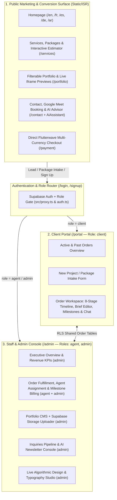

# Virtue & Co. Webworks — Product Architecture & Redesign MVP (`MVP.md`)

> **Application Type:** Hybrid Agency Marketing Storefront + Productized Service Checkout + Client Project Portal + Staff/Admin CMS & Operations Console  
> **Target Outcome for UI Redesign:** Elevate conversion, unify visual identity across all 3 product surfaces (Marketing, Portal, Admin), reconcile pricing/component fragmentation, and complete the end-to-end client-to-payment workflow.

---

## 1. Product Ecosystem Overview

**Virtue & Co. Webworks** is not a static agency brochure; it is a full-stack service delivery platform divided into **three connected surfaces** sharing one design engine and database:

---

## 2. User Roles & Access Control Matrix

Enforced at two layers: **Edge/Node Proxy (`src/proxy.ts`) + Layout Guards (`requireClient` / `requireStaff` / `requireAdmin`)** for routing, and **Supabase PostgreSQL Row Level Security (RLS)** for data isolation.

| Role | Provisioning Method | Accessible Routes | Data Scope (RLS) |
| :--- | :--- | :--- | :--- |
| **Visitor (`anon`)** | Default unauthenticated visitor | All `/{locale}/(marketing)/*` routes, `/login`, `/signup`, `/payment` | Read `published` projects & blog posts, read `site_design`, insert `inquiries` & `subscribers` |
| **Client (`client`)** | Self-signup at `/{locale}/signup` or package/order intake | `/{locale}/portal` and `/{locale}/portal/orders/[reference]` | Read/write **only** their own `orders`, `order_milestones`, and non-internal `order_messages` |
| **Agent (`agent`)** | Promoted in SQL by Admin | `/{locale}/admin/orders` and `/{locale}/admin/orders/[reference]` | Read/update **only** orders where `assigned_agent_id = auth.uid()` (including internal notes) |
| **Admin (`admin`)** | `ADMIN_EMAIL_ALLOWLIST` or `profiles.role = 'admin'` | Full `/admin/*` suite (Overview, Orders, Portfolio CMS, Inquiries, Newsletter, Design Studio) | Full read/write across all tables and storage buckets (`project-media`, `design-fonts`) |

---

## 3. Core MVP Functional Flows

### Flow A: Productized Service Selection & Lead/Order Intake
1. **Discovery:** Visitor browses services via the Homepage (`ServiceShowcase` / `MarketplaceCatalog`), tests scope in the `ProjectEstimator` (`/services`), or asks the Gemini-powered `AiAssistant`.
2. **Conversion Entry Points:**
   - **Standard Inquiry (`/contact`):** Validated by Zod (`contactSchema`), rate-limited, honeypot-protected, saved to `public.inquiries`, and dispatches dual transactional emails via Resend (`enquiry-admin.tsx` + `enquiry-client.tsx`).
   - **Direct Package Intake (`PackageIntakeModal` → `/api/orders/intake`):** Captures selected tier (`starter` / `business` / `enterprise`), creates or links a client account, and initializes an order.
   - **Authenticated Client Request (`NewRequestForm` in `/portal`):** Directly creates a tracked order row (`VCW-YYYY-XXXXXX` reference) in `public.orders`.

### Flow B: Order Lifecycle & Client-Studio Collaboration
1. **8-Stage Status Pipeline (`ORDER_STATUSES`):**
   `inquiry` → `scoping` → `quoted` → `active` → `review` → `delivered` → `closed` (or `cancelled`).
2. **Workspace Capabilities (`/portal/orders/[reference]` & `/admin/orders/[reference]`):**
   - **Client View:** Visual stage progress bar, editable project brief (while in `inquiry`/`scoping`), milestone breakdown (`pending`, `invoiced`, `paid`), and direct message thread with unread counters (`order_message_reads`).
   - **Staff View:** Change order status (automatically logged to `order_events` via DB trigger), assign an agent, create/update milestones, post internal staff-only notes (`internal = true`), or message the client.

### Flow C: Multi-Currency Payment & Webhook Ledger
1. **Checkout Initiation (`/payment` → `/api/payments/initialize`):** Supports `USD ($)`, `NGN (₦)`, `GBP (£)`, and `EUR (€)` via Flutterwave Inline SDK.
2. **Verification & Reconciliation (`/api/payments/verify` & `/api/webhooks/flutterwave`):**
   - Constant-time `verif-hash` signature check.
   - Server-to-server re-query of Flutterwave transaction API to verify exact amount and currency.
   - Idempotent write to `public.transactions` and single-dispatch HTML receipt (`payment-receipt.tsx`).

---

## 4. Database & Backend Readiness Audit

| Migration File | Tables / Buckets Created | Current Status | Action Required for MVP Launch |
| :--- | :--- | :--- | :--- |
| `0001_init.sql` | `profiles`, `projects`, `inquiries`, `transactions` + RLS | **Ready** | None |
| `0002_storage.sql` | `project-media` public storage bucket + admin write policies | **Ready** | None |
| `0003_content.sql` | `posts` (blog), `subscribers` (newsletter) + RLS | **Ready** | None |
| `0004_accounts.sql` | `orders`, `order_messages`, `order_milestones`, `order_message_reads`, `order_events` | **Pending Live Push** | Run `supabase db push` & verify with `supabase/tests/0004_accounts.sql` |
| `0005_design.sql` | `site_design` singleton table + `design-fonts` storage bucket | **Pending Live Push** | Run `supabase db push` to enable saving in `/admin/design` |
| **Milestone ↔ Payment Link** | `order_milestones` ↔ `transactions` | **Unjoined Gap** | Add `milestone_id` / `order_id` reference to `/payment` flow so paying an invoice auto-marks the milestone `paid` |

---

## 5. UI Redesign MVP Scope (Prioritized Tiers)

To make the UI redesign structured, fast, and zero-regression, the redesign is scoped into three priority tiers:

### Tier 1: P0 — Core Visual Identity & High-Conversion Public UI (Must-Have MVP)
- [ ] **Unify Typography & Token Hierarchy (`globals.css` + `tokens.ts`):**
  - Fix the single-weight `Questrial` limitation by pairing a true display font (`Gropled Bold` / `Syne` / `Plus Jakarta Sans`) with a multi-weight UI sans (`Inter` / `Plus Jakarta Sans`).
  - Resolve the visual clash between the flat Gold-on-Charcoal system and the blue/emerald gradients in `Hero` and `SiteHeader`.
- [ ] **Redesign the Marketing Shell (`SiteHeader` + `SiteFooter` + `KineticNav`):**
  - Streamline the header utility bar (reduce visual crowding on tablet/laptop breakpoints between `768px` and `1280px`).
  - Elevate the mobile/drawer navigation (`KineticNav`) and `⌘K` Command Palette into a cohesive luxury studio navigation experience.
- [ ] **High-Converting Homepage Architecture (`/[locale]/page.tsx`):**
  - Re-architect the Hero for immediate visual authority (integrating `DeviceMockup` or interactive showcase alongside the headline).
  - Re-integrate the dormant **`MarketplaceCatalog`** (or unified package tiers), **`BentoGrid`**, **`WebsiteAnatomy`**, and **`ProjectJourney`** so visitors see concrete deliverables, architecture layers, and transparent pricing right from the homepage.
- [ ] **Unified Services & Pricing Experience (`/services`):**
  - Reconcile the pricing numbers across `packages.ts` (`$80–$790`), `ProjectEstimator` (`$150–$950`), and `StartingPrice` (`$100`/`$150`) so every touchpoint quotes one consistent pricing model.
- [ ] **Portfolio & Case Study Showcase (`/portfolio` & `/portfolio/[slug]`):**
  - Upgrade project cards (`PortfolioGrid`) and case study layouts with richer visual framing, device mockups, and smoother preview transitions.

### Tier 2: P1 — Client Portal, Auth & Checkout Experience
- [ ] **Auth Flows (`/login`, `/signup`, `/forgot-password`, `/reset-password`):**
  - Refine `AuthShell` to match the updated typography and surface tokens.
- [ ] **Client Portal Workspace (`/portal` & `/portal/orders/[reference]`):**
  - Redesign the portal sidebar (`PortalNav`), order status timeline (`OrderCard` / `OrderView`), milestone cards, and message thread to feel like a flagship SaaS workspace (Linear/Vercel aesthetic in Virtue Gold & Charcoal).
- [ ] **Integrated Invoice & Milestone Payment (`/payment` + Portal Milestones):**
  - Allow clients to click **"Pay Milestone"** directly inside `/portal/orders/[reference]`, pre-filling `/payment` with the exact milestone amount, currency, and order reference.

### Tier 3: P2 — Staff Console, Design Studio & Polish
- [ ] **Admin Console (`/admin/*`):**
  - Align `AdminNav`, KPI cards, `ProjectsTable`, `InquiriesTable`, and `NewsletterConsole` with the refreshed portal shell.
- [ ] **Motion & Preloader Polish:**
  - Decide whether to mount `BrandLoader` (session-once Remotion intro / SVG monogram draw) or keep instant first paint with `RouteProgress`.

---

## 6. MVP Acceptance Criteria & Quality Gates

Every UI redesign PR/phase must pass these automated and manual checks before shipping:
1. **Design Engine Self-Check:** `npm run verify:design` exits `0` (verifies WCAG contrast floors, Oklab color-flip distance `>= 10` across 1,260 hues, and default gold ramp parity).
2. **Type & Lint Cleanliness:** `npm run typecheck` (`tsc --noEmit` on TypeScript 6.0.3) and `npm run lint` pass with zero errors.
3. **5-Locale + RTL Parity:** Every redesigned component renders cleanly across `en`, `fr`, `es`, `de`, and `ar` (`dir="rtl"`), using logical CSS properties (`ms-*`, `me-*`, `ps-*`, `pe-*`, `start-*`, `end-*`, `text-start`) rather than hardcoded `left`/`right` where directional flow matters.
4. **Theme Parity:** Zero unstyled flash on load, and every surface/border/badge meets contrast targets in both **Light Mode** (`#ffffff` canvas) and **Dark Mode** (`#0c0c0d` canvas).
5. **Accessibility & Performance:** Keyboard `:focus-visible` rings on all interactive controls, `min-h-6` (`24px+`) tap targets on standalone links, and full `prefers-reduced-motion` compliance.
