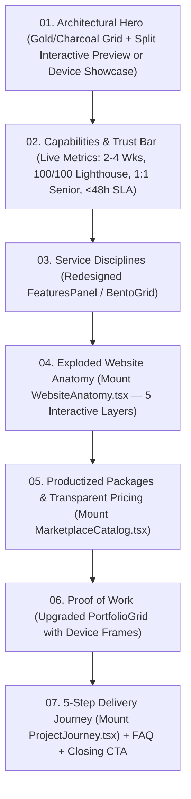

# Virtue & Co. Webworks — UI Redesign Blueprint & Execution Playbook (`UI_REDESIGN_BLUEPRINT.md`)

> **Goal:** A step-by-step architectural guide to redesigning the **Virtue & Co. Webworks** UI without breaking its Next.js 16 App Router plumbing, algorithmic design engine (`verify:design`), 5-locale + Arabic RTL support, or Supabase RLS workflows.

---

## 1. Strategic Redesign Vision

The codebase already has **enterprise-grade engineering** (algorithmic Oklab palette engine, zero-flash theming, 5 locales with RTL, client portal, admin CMS, AI advisor, and Flutterwave checkout). However, the current visual presentation suffers from **"Iteration Drift"** — some components follow an ultra-clean Swiss/Material editorial style (`globals.css`, `FeaturesPanel`, `AboutPage`), while others use SaaS template tropes (`Hero` blue/green radial glows, `Questrial` single-weight faux bolding, and unmounted bento/marketplace sections).

### The Target Redesign Aesthetic: **"Architectural Luxury & Precision Engineering"**
1. **Palette Discipline:** Warm Metallic Gold (`#DCAA28` light / `#E6BB44` dark) on Deep Obsidian Charcoal (`#0C0C0D` / `#141416`) and Pure Alabaster (`#FFFFFF` / `#F6F6F7`). Eliminate off-brand blue (`rgba(59,130,246)`) blooms from the Hero and header.
2. **Typographic Authority:**
   - **Display & Headlines (`--font-display`):** Restore `Gropled Bold` for brand lockups/hero statements OR set a distinctive multi-weight editorial/geometric display face (`Syne`, `Plus Jakarta Sans`, `Space Grotesk`, or `Instrument Serif`) via `tokens.ts`.
   - **Body & UI Controls (`--font-sans`):** Use `Inter` or `Plus Jakarta Sans` (`400`, `500`, `600`, `700`) so weights `500–700` render with true optical hierarchy instead of single-weight `Questrial`.
   - **Technical Specs (`--font-mono`):** Keep crisp uppercase monospace kickers (`text-[11px] tracking-[0.2em]`) for section indices (`01 // ARCHITECTURE`), delivery SLAs, and pricing codes.
3. **Tactile Framing & Depth:** Frame photography, device mockups, and interactive widgets inside double-bezel architectural containers (`rounded-3xl border border-border bg-muted/30 p-2` wrapping an inner `rounded-2xl border border-border bg-card shadow-elevation-2`).

---

## 2. Recommended Page-by-Page Redesign Blueprint

### Phase 1: Design Tokens & Global Shell (`globals.css`, `tokens.ts`, `SiteHeader`, `SiteFooter`)
1. **Font Stack Upgrade (`src/app/[locale]/layout.tsx`, `src/app/globals.css`, `src/lib/design/tokens.ts`):**
   - Map `--font-sans` to `var(--font-inter)` (already loaded in `layout.tsx`!) or `Plus Jakarta Sans`.
   - Map `--font-display` and `.wordmark` to `var(--font-gropled)` or your chosen display face.
   - Keep `npm run verify:design` passing by updating `BRAND_FONT_BODY` and `BRAND_FONT_DISPLAY` in `src/lib/design/tokens.ts`.
2. **Header Refinement (`src/components/site/site-header.tsx`):**
   - Convert the header into a floating or crisp full-width architectural bar (`h-16 sm:h-18`).
   - Replace the blue/emerald nav underline with a crisp `2px` solid gold bar (`bg-primary`) or subtle pill fill (`bg-muted`).
   - Group secondary utilities (`CountrySwitcher`, `ThemeToggle`, `CommandPalette`) cleanly so tablet viewports (`md` to `xl`) never feel cramped.

### Phase 2: Homepage Transformation (`src/app/[locale]/(marketing)/page.tsx`)
Current flow: `Hero` → `QuoteMarquee` → `CapabilitiesBand` → `ServiceShowcase` → `PortfolioGrid` → `Faq` → `CtaBand`.

**Proposed High-Conversion Redesign Flow:**

### Phase 3: Services & Pricing Unification (`src/app/[locale]/(marketing)/services/page.tsx`)
- **Single Source of Truth for Pricing:**
  Update `ProjectEstimator` (`src/components/site/project-estimator.tsx`) and `StartingPrice` (`src/components/site/starting-price.tsx`) to read directly from `AGENCY_SERVICES` in `src/lib/packages.ts` (`$80` Wix Starter floor, `$95` WordPress, `$120` Next.js Custom, `$160` E-Commerce).
- **Mount `MarketplaceCatalog` + `PackageIntakeModal`:** Allow visitors on `/services` to compare `Starter`, `Business`, and `Enterprise` tiers side-by-side and launch the intake modal without leaving the page.

### Phase 4: Client Portal & Admin Console Elevation (`/portal/*` & `/admin/*`)
- **Unified App Shell:** Upgrade `PortalLayout` and `AdminLayout` from basic 2-column grids into a sleek, sticky sidebar + top breadcrumb/status bar layout (`lg:grid-cols-[260px_minmax(0,1fr)]`).
- **Order Detail Workspace (`/portal/orders/[reference]`):**
  - Turn the 8-stage status progression into a visual horizontal stepper bar.
  - Add a direct **"Pay Milestone Now"** CTA on `invoiced` milestones that links to `/{locale}/payment?order={reference}&milestone={id}&amount={amount}&currency={currency}`.

---

## 3. Technical Guardrails (Do Not Break During Redesign)

> [!CAUTION]
> **Critical Architecture Rules to Preserve**

1. **Next.js 16 Conventions (`AGENTS.md`):**
   - Do **not** create `src/middleware.ts` or `src/app/layout.tsx`. Routing and locale headers live in `src/proxy.ts`, and `<html>`/`<body>` live in `src/app/[locale]/layout.tsx`.
   - `params`, `searchParams`, `cookies()`, and `headers()` in Server Components and Route Handlers are **always async** (`await params`).
2. **Design Engine Contract (`npm run verify:design`):**
   - `scripts/design-selfcheck.mjs` compiles `src/lib/design/{tokens,palette,fonts,css}.ts` and asserts that `DEFAULT_DESIGN` in `tokens.ts` matches the `:root` and `.dark` variables in `globals.css` within `±1` RGB rounding step.
   - **Rule:** Whenever you change default colors in `src/app/globals.css`, update `DEFAULT_DESIGN` (and `RATIOS` / `RAMP_LIGHTNESS` if changing the ramp) in `src/lib/design/tokens.ts` and `src/lib/design/palette.ts`, then run `npm run verify:design`.
3. **Internationalization & Arabic RTL (`next-intl`):**
   - Navigation links must use `import { Link, usePathname, useRouter } from '@/i18n/navigation'`, **never** `next/link` directly (except for external URLs or hash anchors).
   - Use directional arrows with RTL rotation (`rtl:rotate-180`) and logical positioning (`start-*`, `end-*`, `ms-*`, `me-*`, `ps-*`, `pe-*`).
4. **Zero External Runtime Asset Leaks:**
   - Keep images sourced from `src/lib/photos.ts` (`public/media/photos/*`) or Supabase Storage (`project-media` bucket) so pages never depend on third-party Unsplash URLs.
